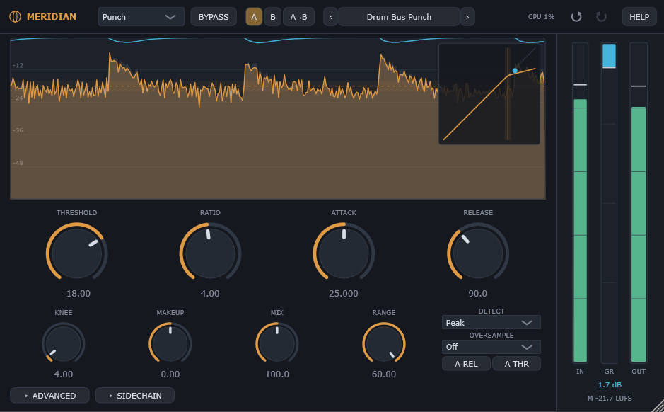
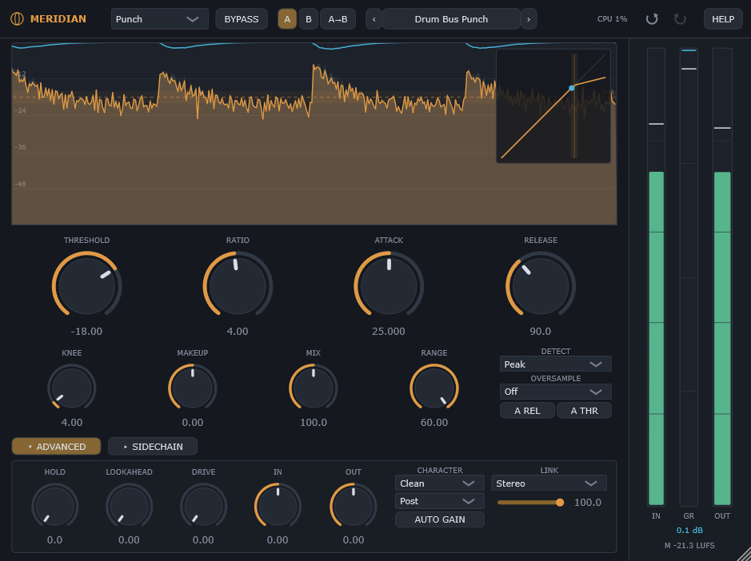
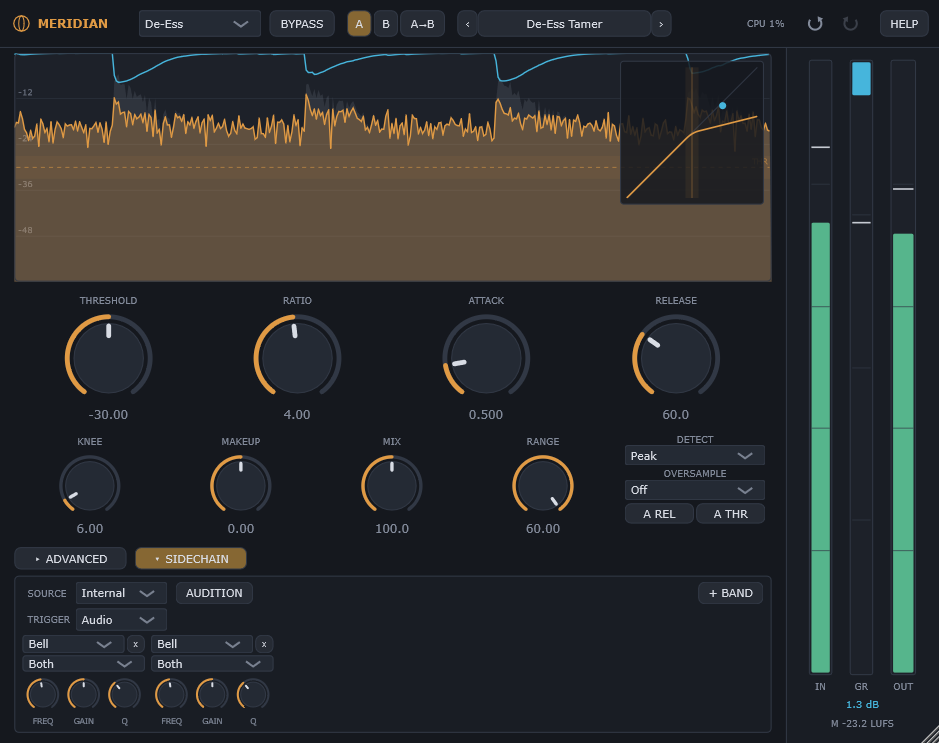

# Meridian

**A free, open-source compressor with 14 compression styles, deep sidechain control
and analog character.**

Meridian goes from transparent mastering glue to vari-mu warmth, opto smoothness,
de-essing and tempo-synced pumping, all from one set of familiar knobs. It is part of
the **Equinox Audio** family alongside [Equinox](https://github.com/JDMcE/Equinox) (EQ),
[Zenith](https://github.com/JDMcE/Zenith) (limiter) and
[Horizon](https://github.com/JDMcE/Horizon) (reverb).



<table>
<tr>
<td></td>
<td></td>
</tr>
<tr>
<td align="center"><sub>Advanced panel</sub></td>
<td align="center"><sub>Sidechain panel</sub></td>
</tr>
</table>

## Features

- **14 compression styles**: Versatile, Smooth, Vari-Mu, Opto, Punch, Upward, Maximize,
  Bus, Mastering, Pump, De-Ess, Limit, Vocal and Digital
- **Full control**: threshold, ratio, attack (down to 0.02 ms), release, knee (0–72 dB),
  makeup, mix (parallel up to 100%, over-compression beyond it) and range
- **Auto Release**, **Auto Threshold** and **Intelligent Auto Gain**
- **Peak or RMS detection**, hold, and up to 20 ms of lookahead
- **Analog character stage**: Clean, Warm, Tape or Drift, before or after compression
- **Up to 32x oversampling**
- **Stereo and Mid/Side**: variable stereo link, or compress Mid or Side only
- **Sidechain**: external input, a 6-band detector-only EQ, and audition
- **Tempo-synced and MIDI-triggered ducking**
- **Metering**: level history with gain-reduction trace, live transfer curve,
  IN/GR/OUT meters and EBU R128 momentary loudness
- **Presets**, **A/B comparison** with independent undo per slot, and **MIDI Learn**
- Built-in manual, hover hints, keyboard control, high-contrast mode, scalable text
  and a freely resizable window

## Download & install

Download the latest build from the
[Releases page](https://github.com/JDMcE/Meridian/releases).

**Windows (64-bit VST3):**

1. Unzip the download.
2. Copy `Meridian.vst3` into `C:\Program Files\Common Files\VST3\`.
3. Restart your DAW or rescan plugins. Meridian appears under **Equinox Audio**.

Prebuilt releases are Windows-only for now. On other platforms you can build from
source (see [For developers](#for-developers)).

## Quick start

1. Pick a **Style** for the job (Vocal, Bus, Mastering...) or start from a preset
   (press `P` to open the browser).
2. Lower **Threshold** until the amber GR trace shows a few dB of reduction on the
   loud parts.
3. Shape it with **Ratio**, **Attack**, **Release** and **Knee**.
4. Bring the level back with **Makeup** (or **Auto Gain** in the Advanced panel).
5. Try alternatives with **A/B**. Each slot keeps its own undo history.

The full manual is built in: click **HELP → Open Manual**. Hover any control (or press
`H`) for a short explanation.

## Compression styles

| Style | Character |
|---|---|
| Versatile | Clean all-rounder; the default |
| Smooth | Gentle RMS levelling with programme-dependent release |
| Vari-Mu | Tube-style: slow, wide knee, ratio grows with drive |
| Opto | Optical: two-stage release that depends on how hard it worked |
| Punch | Transient-forward; attack eases open on peaks |
| Upward | Raises quiet material below the threshold (cap it with Range) |
| Maximize | To-the-max loudness slam |
| Bus | Mix-bus glue; slow and forgiving |
| Mastering | Transparent, slow, low-ratio precision |
| Pump | Aggressive fast-release pumping |
| De-Ess | High-frequency-weighted detection for sibilance |
| Limit | Hard limiting, effectively infinite ratio |
| Vocal | Tuned for dialog and vocal levelling |
| Digital | Classic hard-knee digital: exactly your numbers |

## Sidechain & triggering

Open the **Sidechain** panel (`S`) to switch the detector to your DAW's external
sidechain input. The sidechain EQ (up to 6 bands) shapes only what the detector hears,
so the audio stays untouched; **Audition** lets you listen to it. **Trigger** can
replace audio detection with a tempo-locked pulse (**Host Sync**: rate, offset, pulse
length) or MIDI notes, which gives you sidechain-style ducking without routing a kick.

## Keyboard shortcuts

| Keys | Action |
|---|---|
| `Ctrl+Z` | Undo (active A/B slot) |
| `Ctrl+Shift+Z` / `Ctrl+Y` | Redo |
| `A` / `B` | Switch to state A / B |
| `C` | Copy current state to the other slot |
| `P` | Open / close the preset browser |
| `[` / `]` | Previous / next preset |
| `Shift+B` | Toggle bypass |
| `V` | Toggle Advanced panel |
| `S` | Toggle Sidechain panel |
| `H` | Toggle help hints bar |
| `F1` | Keyboard shortcuts overlay |
| `Esc` | Close overlay / browser |
| `Tab` / `Shift+Tab` | Move focus between controls |
| Arrow keys | Adjust the focused control |

**MIDI Learn:** right-click any knob, choose **MIDI Learn**, then move a controller.

## Presets

Factory presets are built in. User presets are plain `.mrdn` files in
`Documents\Meridian\Presets`, so they are easy to back up, sync or share. Use
**IMPORT** / **EXPORT** in the browser to move them between machines.

## Feedback

Found a bug or have an idea? Please
[open an issue](https://github.com/JDMcE/Meridian/issues).

---

## For developers

### Building

Requirements: CMake 3.22+ and a C++20 compiler (developed with Visual Studio 2022).

Meridian shares code with the rest of the family through
[jdm_shared](https://github.com/JDMcE/jdm_shared), which must be checked out next to
this repository:

```
some-folder/
  Meridian/
  jdm_shared/
```

```
git clone https://github.com/JDMcE/Meridian.git
git clone https://github.com/JDMcE/jdm_shared.git
cd Meridian
git clone --depth 1 --branch 8.0.14 https://github.com/juce-framework/JUCE.git libs/JUCE
cmake -B build
cmake --build build --config Release
```

Targets:

- `meridian_VST3` / `meridian_Standalone`: the plugin
  (VST3 output: `build/meridian_artefacts/Release/VST3/Meridian.vst3`)
- `meridian_tests`: offline DSP verification harness (run the built exe; it exits
  non-zero on failure)

### Project layout

```
src/
  Parameters.h          parameter IDs, ranges, APVTS layout
  PluginProcessor.*     audio processing, metering, state
  PluginEditor.*        UI: header, main display, knobs, Advanced/Sidechain panels
  StateManager.h        forwarder for the shared A/B + undo manager
  dsp/
    CompressorEngine.h  detector, gain computer, styles, ballistics
    CharacterStage.h    Clean/Warm/Tape/Drift saturation
    SidechainEq.h       detector-only sidechain EQ
    LoudnessMeter.h     forwarder for the shared EBU R128 meter
  presets/              product config + factory presets for the shared preset manager
  ui/
    MainDisplay.h       level history, GR trace, transfer curve
    HelpTexts.h         tooltips, shortcut table and the embedded manual
test/
  DspTests.cpp          offline DSP verification harness
```

## License

Meridian is free software, released under the GNU Affero General Public License v3.0;
see [LICENSE](LICENSE). It is built on [JUCE](https://juce.com), used under JUCE's
AGPLv3 open-source licence.
